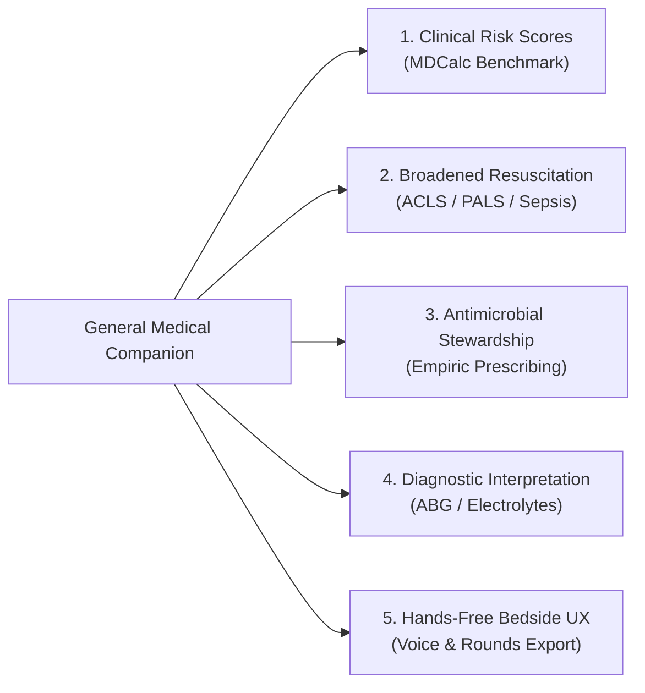

<div align="center">


# Anesthesia — Point-of-Care Clinical Suite for Medical Professionals

*A high-performance, 100% offline-first clinical decision support system, resuscitation toolkit, and medical reference suite engineered for physicians, residents, general practitioners, emergency teams, and healthcare professionals.*

[](https://nextjs.org/)
[](https://react.dev/)
[](https://tailwindcss.com/)
[](https://motion.dev/)
[](https://dexie.org/)
[](https://www.gnu.org/licenses/gpl-3.0)

</div>

---

## 🩺 The Mission: "Anesthesia is Just the Name"

> [!IMPORTANT]
> **This application is NOT strictly for anesthetists.**  
> *"Anesthesia"* is the project's historical name, but the application is designed and engineered as a comprehensive, point-of-care medical toolkit for **medical professionals in general** — including general practitioners (GPs), internal medicine physicians, hospitalists, emergency physicians, pediatricians, residents, nurses, and acute care teams.

Modern hospital medicine demands rapid, error-free clinical calculations and immediate access to evidence-based protocols. However, most commercial clinical apps suffer from slow network load times, aggressive paywalls, fragmented user experiences, or failure to function in underground hospital wards and Faraday-shielded resuscitation suites.

**Anesthesia** bridges this gap: a zero-latency, offline-capable clinical workstation combining the mathematical rigor of **MDCalc**, the drug interaction safety of **Epocrates**, the rapid guidance of **UpToDate**, and the emergency readiness of advanced acute life-support protocols into one unified, distraction-free interface.

---

## ⚖️ Benchmarking Against Industry Standards

| Clinical Dimension | Commercial Apps (MDCalc / Epocrates / UpToDate) | **Anesthesia Suite** |
|---|---|---|
| **Connectivity** | Requires stable cellular / Wi-Fi connection; often fails in shielded hospital basements | **100% Offline-First:** Dexie IndexedDB client storage caches all calculators, guidelines, and 14,000+ ICD-10 codes locally |
| **Workflow Friction** | Separate apps for calculators (MDCalc), drug checks (Epocrates), guidelines (UpToDate), and code lookup (ICD-10) | **Unified Bedside Station:** Universal `Cmd+K` palette, persistent Active Patient Tray, and cross-tool parameter sharing |
| **Emergency Resuscitation** | Requires multi-step menu navigation and recalculation under stress | **Zero-Latency Crisis Card:** Weight-calculated rapid push doses (ACLS, shock, anaphylaxis, toxicities) with 1-tap clipboard copy |
| **Diagnostic Simulation** | Static text descriptions or paywalled stock images | **Interactive 12-Lead ECG Engine:** Realtime SVG waveforms on calibrated 1mm/5mm grid with interactive case learning |
| **Privacy & Access** | Mandatory cloud login, patient data telemetry, and costly subscriptions | **Completely Local & Free:** Open-source (GPL v3), zero patient data leaves the browser, no subscription barriers |

---

## ⚡ Core Capabilities & Features

### 1. Decoupled Route Architecture (Next.js 16 App Router)
* **Public Landing Page (`/` — Persuade Mode):** Authoritative clinical portal featuring an interactive real-time patient weight slider, instant dosing calculations (Propofol, Rocuronium, Fentanyl, Sugammadex, Holliday-Segar fluid maintenance), and an animated programmatic SVG sinus rhythm monitor.
* **Clinical Command Center (`/dashboard` — Operate Mode):** A distraction-free workspace organized into functional medical categories:
  * *Acute Care & Crisis Protocols*
  * *Critical Care & Bedside Calculators*
  * *Clinical Assessment, Guidelines & Pharmacology*

### 2. Emergency & Resuscitation Crisis Card (`/emergency`)
One-click weight-calculated rapid push doses with tactile copy-to-clipboard feedback:
* **Cardiac Arrest (ACLS):** Epinephrine ($0.01\text{ mg/kg}$ / $0.1\text{ mg/mL}$ volume calculation), Amiodarone ($300\text{ mg} \to 150\text{ mg}$).
* **Hemodynamic Instability & Shock:** Ephedrine, Phenylephrine, Atropine.
* **Severe Anaphylaxis:** Epinephrine IM ($0.01\text{ mg/kg}$ up to $0.5\text{ mg}$), Diphenhydramine, Hydrocortisone.
* **Acute Airway & Laryngospasm:** Succinylcholine, Sugammadex routine ($2\text{ mg/kg}$) vs immediate rescue ($16\text{ mg/kg}$).
* **Toxicities & Critical Emergencies:** Malignant Hyperthermia (Dantrolene $2.5\text{ mg/kg}$ with vial counter and sterile water reconstitution) and LAST (20% Lipid Emulsion bolus and infusion rates).

### 3. Active Case Session Tray
* Persistent patient parameters (`Weight`, `Height`, `Age`, `Sex`, `ASA Class`, `Mallampati`) stored in Zustand with local storage persistence.
* Tactile weight adjustment steppers (`-5kg`, `-1kg`, `+1kg`, `+5kg`) and rapid presets (`10kg` to `100kg`).
* Automatically pre-populates all formulas across Medical Calculators and Drug Dosing without repetitive data entry.

### 4. Bedside Medical Calculators (`/calculators` & `/dosage`)
* **Renal Clearance:** Cockcroft-Gault Creatinine Clearance (CrCl) and eGFR equations for bedside antibiotic and drug adjustments.
* **Anthropometrics & Body Composition:** BMI, Ideal Body Weight (IBW - Devine formula), and Adjusted Body Weight (ABW) for hydrophilic drug calculations.
* **Hemodynamics & Respiratory:** Mean Arterial Pressure (MAP), Allowable Blood Loss (ABL), PaO2/FiO2 ratio (Berlin ARDS definition), and Holliday-Segar (4-2-1) maintenance fluid rates.
* **Airway Geometry:** Pediatric and adult endotracheal tube (ETT) diameter and depth estimation formulas.

### 5. 12-Lead ECG Simulator & Case Quiz (`/ecg`)
* Calibrated SVG waveform generator simulating standard 25 mm/s and 10 mm/mV pink grid paper.
* Interactive pathologies: STEMI (Anterior, Inferior, Lateral), Wellens Syndrome, Brugada Type 1 & 2, Hyperkalemia, Pericarditis, and continuous sinus rhythm strips.
* Integrated clinical case quiz with progressive hint reveals and differential reasoning.

### 6. Universal Command Palette (`Cmd + K` / `Ctrl + K`)
* Keyboard-driven instant navigation across all 19 tools, calculators, crisis protocols, clinical guidelines, and diagnostic coding.

### 7. Drug Interaction Safety Matrix & Formulary (`/interactions` & `/formulary`)
* Multi-drug cross-reaction analysis with categorized severity indicators.
* Comprehensive clinical pharmacology database covering indications, adult and pediatric dosing, contraindications, and routes of administration.

### 8. Physical Examination & Anatomical Map (`/physical-exam`)
* Interactive 2D anatomical selector map with structured step-by-step physical examination procedures, normal versus abnormal clinical findings, and airway scoring.

### 9. Zero-Latency Offline Storage & Diagnostic Search (`/icd10` & `/guidelines`)
* Client-side IndexedDB database powered by Dexie.
* 14,000+ searchable ICD-10 diagnostic codes and structured Clinical Practice Guidelines (CPGs) across medical specialties function seamlessly without internet access.

### 10. Impeccable Motion & Minimalist Design System
* Built according to the Impeccable design standard (zero generic AI slop, no neon gradients, no decorative animation clutter).
* Restrained surgical slate palette (`#080c15` / `#0e1424`) with tabular monospace typography for numerical dosages.
* Hardware-accelerated transitions with full respect for `prefers-reduced-motion`.

### 11. Full Bilingual Support
* Native clinical parity in **English (`en`)** and **Indonesian (`id`)**.

---

## 🛠️ Tech Stack

| Layer | Technologies |
|---|---|
| **Framework** | Next.js 16.4.2 (App Router with Turbopack) |
| **UI & Styling** | React 19.3.1, Tailwind CSS 4.3.3, Lucide React |
| **Motion Engine** | Motion 12.43.0 (hardware-accelerated transforms, layoutId FLIP) |
| **State & Session** | Zustand 5.0.15 (with local storage persistence) |
| **Offline Storage** | Dexie 4.4.6, idb-keyval 6.3.0 |
| **AI Integration** | Google Gemini API, GROQ, OpenAI-compatible endpoints |
| **Reports & Export** | pdfmake, html-to-pdfmake |

---

## 🚀 Strategic Product Roadmap for General Medicine

To expand from acute care into the ultimate everyday clinical companion for all medical professionals, development is focused on five core pillars:



### Pillar 1: Evidence-Based Clinical Risk Scores (MDCalc Benchmark)
- [ ] **Cardiovascular & Thromboembolism:**
  - `CHA2DS2-VASc` score for atrial fibrillation stroke risk and anticoagulation threshold.
  - `Wells Score` for DVT and Pulmonary Embolism with PERC rule integration.
  - `HEART Score` for chest pain risk stratification in emergency departments.
- [ ] **Pulmonology & Infectious Disease:**
  - `CURB-65` and `Pneumonia Severity Index (PSI)` for pneumonia admission triage.
  - `qSOFA` and `SOFA` criteria for sepsis identification and organ dysfunction tracking.
- [ ] **Neurology & Critical Care:**
  - `Glasgow Coma Scale (GCS)` interactive calculator with pediatric modifications.
  - `NIH Stroke Scale (NIHSS)` step-by-step scoring with tPA contraindication checklist.
- [ ] **Gastroenterology & Hepatology:**
  - `MELD-Na` and `Child-Pugh` score for end-stage liver disease mortality and drug dosing risk.

### Pillar 2: Broadened Resuscitation & Emergency Protocols
- [ ] **ACLS & PALS Interactive Timers:** Synchronized 2-minute CPR cycle timer with rhythm check prompts, shock delivery tracker, and automated Epinephrine / Amiodarone intervals.
- [ ] **Pediatric Emergency Tape (Broselow Equivalent):** Rapid color-coded weight and length-based emergency drug dosing and resuscitation equipment guide.
- [ ] **Status Epilepticus Pathway:** First-line benzodiazepine dosing (Midazolam / Lorazepam) transitioning to second-line IV Levetiracetam / Valproate.
- [ ] **Hypertensive Crisis Protocol:** Dosing and titration guides for IV Labetalol, Hydralazine, and Nicardipine with target blood pressure reduction parameters.

### Pillar 3: Antimicrobial Stewardship & Empiric Therapy
- [ ] **Syndrome-Based Antibiotic Selector:** First-line and alternative empiric regimens for community-acquired pneumonia, acute pyelonephritis, cellulitis, meningitis, and intra-abdominal sepsis.
- [ ] **Renal Dose Adjustment Alerts:** Automated flags and dose-reduction recommendations based on patient CrCl/eGFR calculated from the Active Case Tray.
- [ ] **Vancomycin & Aminoglycoside Dosing Guide:** Trough-target calculators and extended-interval dosing regimens.

### Pillar 4: Laboratory & Diagnostic Interpretation Engines
- [ ] **Arterial Blood Gas (ABG) Analyzer:** 4-step acid-base interpretation (metabolic vs respiratory, anion gap calculation, Winter's formula for compensation, and Delta-Delta ratio for mixed disorders).
- [ ] **Electrolyte Correction Calculators:**
  - Sodium correction in hyperglycemia ($[\text{Na}^+] + 0.016 \times (\text{Glucose} - 100)$).
  - Free water deficit in hypernatremia.
  - Calcium correction for hypoalbuminemia.
  - Potassium repletion protocol with IV vs oral safety limits.

### Pillar 5: Hands-Free Bedside Workflows & Documentation
- [ ] **Clinical Shift Rounds Summary:** One-tap PDF generation summarizing patient vitals, calculated scores, fluid rates, and drug regimens for handoffs.
- [ ] **Voice-Activated Lookups:** Hands-free PWA voice queries for sterile procedure fields and resuscitation bays.

---

## 💻 Getting Started

### Prerequisites
* **Node.js**: v20+ (tested on Node v20, v22, and v26)
* **npm** or **pnpm**
* Optional: GROQ API Key or Google Gemini API Key for AI-assisted differential diagnosis

### Installation

1. **Clone the repository:**
   ```bash
   git clone https://github.com/rizqihan/Anesthesia.git
   cd Anesthesia
   ```

2. **Install dependencies:**
   ```bash
   npm install
   ```

3. **Configure Environment Variables (Optional):**
   Create a `.env.local` file in the project root:
   ```env
   # Optional: For AI Symptom Checker & Clinical Guidance
   GROQ_API_KEY=your_groq_api_key_here
   GEMINI_API_KEY=your_gemini_api_key_here
   ```

4. **Start the Development Server:**
   ```bash
   npm run dev
   ```

5. **Build for Production:**
   ```bash
   npm run build
   npm run start
   ```

Open [http://localhost:3000](http://localhost:3000) in your browser.

---

## 📂 Project Structure

```
Anesthesia/
├── app/
│   ├── (marketing)/           # Public-facing landing page (Persuade Mode)
│   │   ├── layout.tsx         # Marketing topbar & footer
│   │   └── page.tsx           # Interactive weight slider & live dosing HUD
│   ├── (app)/                 # Authenticated / Clinical Workspace (Operate Mode)
│   │   ├── layout.tsx         # Clinical AppShell wrapper
│   │   ├── dashboard/         # Command Center categorized workspaces
│   │   ├── emergency/         # Resuscitation & crisis push doses
│   │   ├── calculators/       # Renal, fluid, hemodynamic & airway formulas
│   │   ├── dosage/            # Pediatric & adult weight-based dosing
│   │   ├── ecg/               # 12-lead calibrated SVG simulator & quiz
│   │   ├── interactions/      # Multi-drug interaction safety matrix
│   │   ├── formulary/         # Clinical pharmacology & routes
│   │   ├── physical-exam/     # 2D clickable body map & airway exam
│   │   ├── symptoms/          # Differential diagnosis assistant
│   │   ├── guidelines/        # Clinical Practice Guidelines (CPGs)
│   │   ├── icd10/             # Offline 14,000+ ICD-10 search
│   │   └── settings/          # Local storage, language, backup & restore
│   ├── layout.tsx             # Root layout with fonts & PWA metadata
│   ├── template.tsx           # Motion transitions (hardware-accelerated)
│   └── globals.css            # Tailwind 4 styling & CSS variables
├── components/
│   ├── ActiveCaseModal.tsx    # Patient parameters tray (Weight, Height, ASA)
│   ├── CommandPalette.tsx     # Cmd+K universal search across all tools
│   ├── AppShell.tsx           # Clinical workspace sidebar and topbar
│   └── Navigation.tsx         # Navigation header and language toggle
├── store/
│   └── appStore.ts            # Zustand global state (Active Case, Language, Settings)
├── lib/
│   ├── db.ts                  # Dexie IndexedDB offline schema
│   ├── calculators.ts         # Validated medical equations
│   ├── drugs.ts               # Pharmacopeia database
│   └── i18n.ts                # English & Indonesian clinical dictionary
└── public/
    └── manifest.json          # Progressive Web App manifest
```

---

## 📜 Medical Disclaimer

> [!CAUTION]
> **For Educational and Clinical Decision Support Reference Only.**  
> This software is intended to assist qualified healthcare professionals and medical students. It does not substitute for independent professional medical judgment, diagnosis, or treatment. Always verify calculated dosages, drug concentrations, and institutional protocols before administering therapy to patients.

---

## 📄 License

This project is open-source and licensed under the **GNU General Public License v3.0**. See the [LICENSE](LICENSE) file for complete details.
