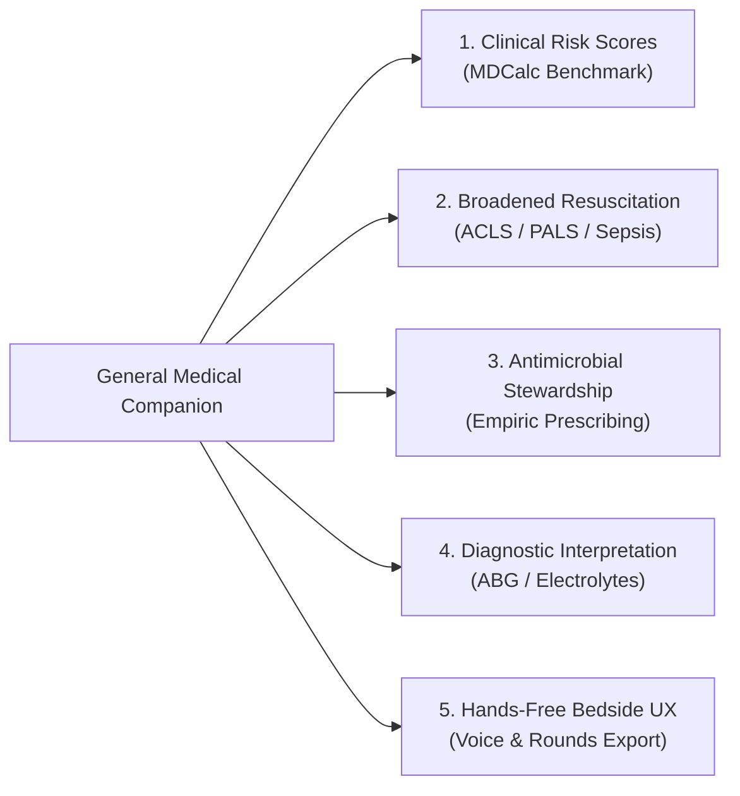

<div align="center">


# Anesthesia — Point-of-Care Clinical Suite for Medical Professionals

*A high-performance, 100% offline-first clinical decision support system, resuscitation toolkit, and medical reference suite engineered for physicians, residents, general practitioners, emergency teams, and healthcare professionals.*

[](https://nextjs.org/)
[](https://react.dev/)
[](https://tailwindcss.com/)
[](https://motion.dev/)
[](https://github.com/rizqihan/Anesthesia)
[](https://developer.mozilla.org/en-US/docs/Web/API/Web_Speech_API)
[](https://dexie.org/)
[](https://www.gnu.org/licenses/gpl-3.0)

</div>

---

## 🩺 The Mission: "Anesthesia is Just the Name"

> [!IMPORTANT]
> **This application is NOT strictly for anesthetists.**  
> *"Anesthesia"* is the project's historical name, but the application is designed and engineered as a comprehensive, point-of-care medical toolkit for **medical professionals in general** — including general practitioners (GPs), internal medicine physicians, hospitalists, emergency physicians, pediatricians, residents, nurses, and acute care teams.

Modern hospital medicine demands rapid, error-free clinical calculations and immediate access to evidence-based protocols. However, most commercial clinical apps suffer from slow network load times, aggressive paywalls, fragmented user experiences, or failure to function in underground hospital wards and Faraday-shielded resuscitation suites.

**Anesthesia** bridges this gap: a zero-latency, offline-capable clinical workstation combining the mathematical rigor of **MDCalc**, the drug interaction safety of **Epocrates**, the rapid guidance of **UpToDate**, and the emergency readiness of advanced acute life-support protocols into one unified, distraction-free interface.

---

## ⚖️ Benchmarking Against Industry Standards

| Clinical Dimension | Commercial Apps (MDCalc / Epocrates / UpToDate) | **Anesthesia Suite** |
|---|---|---|
| **Connectivity** | Requires stable cellular / Wi-Fi connection; often fails in shielded hospital basements | **100% Offline-First:** Dexie IndexedDB client storage caches all calculators, guidelines, and 14,000+ ICD-10 codes locally |
| **Workflow Friction** | Separate apps for calculators (MDCalc), drug checks (Epocrates), guidelines (UpToDate), and code lookup (ICD-10) | **Unified Bedside Station:** Universal `Cmd+K` palette, persistent Active Patient Tray, and cross-tool parameter sharing |
| **Emergency Resuscitation** | Requires multi-step menu navigation and recalculation under stress | **Zero-Latency Crisis Card:** Weight-calculated rapid push doses (ACLS, shock, anaphylaxis, toxicities) with 1-tap clipboard copy |
| **Diagnostic Simulation** | Static text descriptions or paywalled stock images | **Interactive 12-Lead ECG Engine:** Realtime SVG waveforms on calibrated 1mm/5mm grid with interactive case learning |
| **Privacy & Access** | Mandatory cloud login, patient data telemetry, and costly subscriptions | **Completely Local & Free:** Open-source (GPL v3), zero patient data leaves the browser, no subscription barriers |

---

## ⚡ Core Capabilities & Features

### 1. Bedside Voice Assistant & Hands-Free Lookups (`Cmd + M` / `Ctrl + M`)
* **Sterile Field & Resuscitation Operation:** Zero-latency speech recognition powered by the native **Web Speech API** for scrubbed procedural fields (central lines, epidural/spinals) and emergency bays.
* **Intelligent Clinical Intent Parser:** Bilingual (`en` & `id`) regex/token matching for 163 drugs, push-dose recipes, and medical calculators.
* **Look-Alike / Sound-Alike (LASA) Acoustic Safeguards:** Proactive acoustic collision detection warning against dangerous sound-alikes (e.g., *Epinephrine* vs *Ephedrine*, *Hydralazine* vs *Hydroxyzine*, *Cefazolin* vs *Ceftriaxone*, *Dopamine* vs *Dobutamine*).
* **Continuous Scrub Mode:** Keeps listening between queries with real-time waveform visualizers and automated **Text-to-Speech (TTS)** voice readback.
* **Active Case Voice Mutations:** Hands-free verbal updates to patient parameters (e.g., *"Set patient weight 68 kg"*, *"Ubah tinggi badan 165 cm"*).

### 2. Emergency & Resuscitation Crisis Card (`/emergency`)
* **Multi-Method Push-Dose Epinephrine:** Dilution recipes for $10\ \mu\text{g/mL}$ (ampule in $100\text{ mL}$ bag vs $1\text{ mL}$ in $9\text{ mL}$ syringe) with strict 10x overdose protection.
* **Cardiac Arrest (ACLS):** Synchronized 2-minute CPR cycle timer with rhythm check prompts, shock counter, and automated Epinephrine / Amiodarone intervals.
* **Pediatric Broselow Emergency Tape:** Color-coded weight/length zones with endotracheal tube sizes, blade types, and resuscitation drug doses.
* **Crisis Pathways:** Status Epilepticus 4-phase escalation protocol, Hypertensive Crisis MAP titration, and Anaphylaxis IM vs monitored IV protocols.
* **Toxicities & Critical Antidotes:** Malignant Hyperthermia (Dantrolene $2.5\text{ mg/kg}$ with vial calculator) and LAST (20% Lipid Emulsion bolus and infusion rates).

### 3. Point-of-Care Ultrasound (POCUS) Suite (`/pocus`)
* **Bedside USG Protocols:** Guided views and clinical checklists for eFAST (RUQ, LUQ, Pelvis, Subxiphoid), BLUE protocol lung points, FOCUS cardiac views, and DVT vascular access.
* **Quantitative Caliper Engines:** Real-time IVC collapsibility index (spontaneous breathing) & distensibility index (mechanical ventilation), 3-axis bladder volume calculation, and elliptical area measurement.
* **High-Fidelity Pathology Atlas & DICOM:** Vector ultrasound graphics and multi-frame DICOM cine-loop viewer.

### 4. Antimicrobial Stewardship & SBAR Handoff (`/antimicrobial`)
* **Syndromic Empiric Antibiotic Selector:** First-line and alternative regimens for pneumonia, pyelonephritis, intra-abdominal sepsis, cellulitis, and meningitis.
* **Renal Dose Safety Cutoffs:** Automated flags based on Cockcroft-Gault CrCl and race-free CKD-EPI 2021 eGFR with Cefepime neurotoxicity warnings.
* **Therapeutic Drug Monitoring Nomograms:** Vancomycin AUC/trough targets and Hartford aminoglycoside once-daily extended-interval nomograms.
* **Bedside Rounds SBAR PDF Export:** One-tap hospital handoff sheet compiling active vitals, renal metrics, and crisis dosing.

### 5. Evidence-Based Clinical Risk Scores & Calculators (`/calculators` & `/dosage`)
* **Cardiovascular & Hemodynamics:** Wells DVT and PE (with PERC rule), CHA₂DS₂-VASc, HAS-BLED, HEART Score for chest pain, Glasgow-Blatchford (GBS), Shock Index, and Mean Arterial Pressure (MAP).
* **Critical Care & Sepsis:** CURB-65, Pneumonia Severity Index (PSI), qSOFA, SOFA, Glasgow Coma Scale (GCS & GCS-P), and NIHSS with tPA contraindications checklist.
* **Hepatology & Renal:** MELD-Na, Child-Pugh, Cockcroft-Gault CrCl, and CKD-EPI 2021 eGFR.
* **Airway & Surgery:** Endotracheal tube (ETT) diameter and lip depth estimation, Allowable Blood Loss (ABL), and Holliday-Segar fluid maintenance rates.

### 6. Diagnostic Lab Engines & 4-Step ABG Analyzer
* **Arterial Blood Gas (ABG) Interpreter:** 4-step acid-base interpretation (metabolic vs respiratory, Anion Gap, Winter's formula compensation, and Delta-Delta ratio for mixed disorders).
* **Electrolyte Safety Calculators:** Hyperglycemia-corrected sodium, free water deficit in hypernatremia, hypoalbuminemia-corrected calcium, and potassium repletion safety rules.

### 7. ASRA Regional Coagulation & Syringe Pump Titrator
* **ASRA Coagulation Matrix:** Evidence-based neuraxial and deep peripheral block safety intervals for anticoagulants (Warfarin INR targets, DOAC washout times, Heparin, and antiplatelets).
* **Vasoactive Syringe Pump Titrator:** Real-time infusion rate calculators ($\mu\text{g/kg/min}$, $\mu\text{g/min}$, $\text{mL/hr}$) for Norepinephrine, Epinephrine, Dopamine, Dobutamine, Nicardipine, and Vasopressin.

### 8. 163-Drug General Hospital Pharmacopeia (`/formulary` & `/interactions`)
* **Multi-Specialty Formulary:** Dosing, indications, contraindications, routes, and clinical pearls across acute care, anesthesia, antibiotics, analgesics, and cardiology.
* **Clinical Safety Caps:** Strict upper-bound capping preventing computational overdoses.
* **Drug Interaction Matrix:** Offline multi-drug cross-reaction evaluation highlighting fatal and contraindicated sedative/anesthetic combinations.

### 9. WHO Child Growth & Pediatric Tools
* **WHO Growth Standards:** Real-time z-scores and percentiles for weight-for-age, height-for-age, and weight-for-height.
* **Neonatal & Infant Scores:** APGAR scoring and Silverman-Anderson respiratory distress index.

### 10. Active Case Session Tray & Structured SOAP Note Generator
* **Persistent Patient Tray:** Real-time global parameters (`Weight`, `Height`, `Age`, `Sex`, `ASA Class`, `Mallampati`) stored in Zustand with local persistence.
* **Structured Clinical SOAP Notes:** 1-tap generation of EHR-ready progress notes (CPPT in Indonesian / SOAP in English) from active case data, labs, and calculated scores.

### 11. 12-Lead Calibrated SVG ECG Simulator & Case Quiz (`/ecg`)
* Calibrated SVG waveform generator simulating standard $25\text{ mm/s}$ and $10\text{ mm/mV}$ pink grid paper.
* Interactive pathologies: STEMI (Anterior, Inferior, Lateral), Wellens Syndrome, Brugada Type 1 & 2, Hyperkalemia, and Pericarditis with progressive case quiz drills.

### 12. Physical Examination & Anatomical Map (`/physical-exam`)
* Interactive 2D anatomical selector map with structured step-by-step physical examination procedures, normal versus abnormal clinical findings, and airway Mallampati evaluation.

### 13. Zero-Latency Offline PWA & 1-Tap Bedside Installation
* **PWA Service Worker:** Comprehensive client-side caching of all 16 clinical routes and Next.js assets.
* **Automated Data Auto-Seeding:** Seamless client startup auto-seeding across Dexie IndexedDB datasets without blocking UI modals.
* **1-Tap Standalone Install:** Platform-aware install modal for iOS Safari, Android, and Desktop.

### 14. Dual-Theme Engine with Medical Monitor Isolation
* High-contrast **Light Mode** for bright outpatient clinics & **Dark Mode** for dimmed ORs and ICUs.
* **Medical Monitor Isolation (`data-preserve-dark`):** Dedicated scotopic black viewports (`#030712`) preserving physiological telemetry contrast for ECG waveforms and POCUS ultrasound scans.

### 15. Universal Command Palette (`Cmd + K` / `Ctrl + K`)
* Keyboard-driven instant navigation across all tools, calculators, crisis protocols, clinical guidelines, and diagnostic coding.

### 16. Full Bilingual Clinical Parity
* Native clinical parity in **English (`en`)** and **Indonesian (`id`)** across all calculators, emergency protocols, guidelines, and voice commands.

---

## 🛠️ Tech Stack

| Layer | Technologies | Description |
|---|---|---|
| **Core Framework** | Next.js 16.4.6 (App Router & Turbopack) | Server and client hybrid architecture with zero-latency route prefetching |
| **Runtime & Language** | Node.js 20+, TypeScript 5.9.3, React 19.2.1 | Strict type safety, React 19 compiler optimizations & concurrent hydration |
| **Styling & Design System** | Tailwind CSS 4.3.5, PostCSS 8.5.33, Lucide React 0.553.0 | Surgical slate palette, responsive mobile clinical HUD, dual-theme engine |
| **Motion Engine** | Motion 12.38.0 | Hardware-accelerated modal transitions, audio waveforms, and layout FLIP |
| **Voice & Speech Engine** | Web Speech API (`SpeechRecognition` & `SpeechSynthesis`) | Hands-free bedside voice queries, sterile scrub mode, and audio readback |
| **State Management** | Zustand 5.1.0 | Reactive Active Case sync, persistent local settings, and patient labs |
| **Offline Storage** | Dexie 4.4.7 (IndexedDB schema v9), idb-keyval 6.2.2, localforage | 100% offline client storage, zero-latency caching, auto-seeding datasets |
| **PWA Architecture** | Service Worker, Web App Manifest, Standalone PWA Engine | 1-tap installation modal, fullscreen standalone mode, offline fallbacks |
| **Clinical Pharmacology** | Curated 163-Drug Hospital Database | Upper-bound safety caps, dilution recipes, and pediatric/adult dosing |
| **Medical Safety & Regs** | LASA Acoustic Rules, ASRA Coags, WHO Growth Standards | High-alert sound-alike warnings, neuraxial washouts, z-score percentiles |
| **Clinical Documentation** | Custom SBAR & SOAP Generator, pdfmake | EHR-ready progress notes (CPPT/SOAP) and 1-tap rounds SBAR PDF export |
| **Clinical AI Integration** | Google GenAI SDK (`@google/genai` 1.17.0), Groq API, OpenAI-compatible | Offline differential fallbacks + optional dynamic LLM diagnostic reasoning |

---

## 🚀 Strategic Product Roadmap for General Medicine

To expand from acute care into the ultimate everyday clinical companion for all medical professionals, development is focused on five core pillars:



### Pillar 1: Evidence-Based Clinical Risk Scores (MDCalc Benchmark)
- [x] **Cardiovascular & Thromboembolism:**
  - `CHA2DS2-VASc` score for atrial fibrillation stroke risk and anticoagulation threshold.
  - `Wells Score` for DVT and Pulmonary Embolism with PERC rule integration.
  - `HEART Score` for chest pain risk stratification in emergency departments.
- [x] **Pulmonology & Infectious Disease:**
  - `CURB-65` and `Pneumonia Severity Index (PSI)` for pneumonia admission triage.
  - `qSOFA` and `SOFA` criteria for sepsis identification and organ dysfunction tracking.
- [x] **Neurology & Critical Care:**
  - `Glasgow Coma Scale (GCS)` interactive calculator with pediatric modifications.
  - `NIH Stroke Scale (NIHSS)` step-by-step scoring with tPA contraindication checklist.
- [x] **Gastroenterology & Hepatology:**
  - `MELD-Na` and `Child-Pugh` score for end-stage liver disease mortality and drug dosing risk.

### Pillar 2: Broadened Resuscitation & Emergency Protocols
- [x] **ACLS & PALS Interactive Timers:** Synchronized 2-minute CPR cycle timer with rhythm check prompts, shock delivery tracker, and automated Epinephrine / Amiodarone intervals.
- [x] **Pediatric Emergency Tape (Broselow Equivalent):** Rapid color-coded weight and length-based emergency drug dosing and resuscitation equipment guide.
- [x] **Status Epilepticus Pathway:** First-line benzodiazepine dosing (Midazolam / Lorazepam) transitioning to second-line IV Levetiracetam / Valproate.
- [x] **Hypertensive Crisis Protocol:** Dosing and titration guides for IV Labetalol, Hydralazine, and Nicardipine with target blood pressure reduction parameters.

### Pillar 3: Antimicrobial Stewardship & Empiric Therapy
- [x] **Syndrome-Based Antibiotic Selector:** First-line and alternative empiric regimens for community-acquired pneumonia, acute pyelonephritis, cellulitis, meningitis, and intra-abdominal sepsis.
- [x] **Renal Dose Adjustment Alerts:** Automated flags and dose-reduction recommendations based on patient CrCl/eGFR calculated from the Active Case Tray.
- [x] **Vancomycin & Aminoglycoside Dosing Guide:** Trough-target calculators and extended-interval dosing regimens.

### Pillar 4: Laboratory & Diagnostic Interpretation Engines
- [x] **Arterial Blood Gas (ABG) Analyzer:** 4-step acid-base interpretation (metabolic vs respiratory, anion gap calculation, Winter's formula for compensation, and Delta-Delta ratio for mixed disorders).
- [x] **Electrolyte Correction Calculators:**
  - Sodium correction in hyperglycemia ($[\text{Na}^+] + 0.016 \times (\text{Glucose} - 100)$).
  - Free water deficit in hypernatremia.
  - Calcium correction for hypoalbuminemia.
  - Potassium repletion protocol with IV vs oral safety limits.

### Pillar 5: Hands-Free Bedside Workflows & Documentation
- [x] **Clinical Shift Rounds Summary:** One-tap PDF generation summarizing patient vitals, calculated scores, fluid rates, and drug regimens for handoffs.
- [x] **Voice-Activated Lookups:** Hands-free PWA voice queries for sterile procedure fields and resuscitation bays.

---

## 💻 Getting Started

### Prerequisites
* **Node.js**: v20+ (tested on Node v20, v22, and v26)
* **npm** or **pnpm**
* Optional: GROQ API Key or Google Gemini API Key for AI-assisted differential diagnosis

### Installation

1. **Clone the repository:**
   ```bash
   git clone https://github.com/rizqihan/Anesthesia.git
   cd Anesthesia
   ```

2. **Install dependencies:**
   ```bash
   npm install
   ```

3. **Configure Environment Variables (Optional):**
   Create a `.env.local` file in the project root:
   ```env
   # Optional: For AI Symptom Checker & Clinical Guidance
   GROQ_API_KEY=your_groq_api_key_here
   GEMINI_API_KEY=your_gemini_api_key_here
   ```

4. **Start the Development Server:**
   ```bash
   npm run dev
   ```

5. **Build for Production:**
   ```bash
   npm run build
   npm run start
   ```

Open [http://localhost:3000](http://localhost:3000) in your browser.

---

## 📂 Project Structure

```
Anesthesia/
├── app/
│   ├── (app)/                 # Unified Clinical Workspace (Operate Mode)
│   │   ├── layout.tsx         # Clinical AppShell wrapper
│   │   ├── dashboard/         # Command Center categorized workspaces
│   │   ├── emergency/         # Resuscitation, ACLS timer & push doses
│   │   ├── antimicrobial/     # Empiric stewardship & rounds SBAR export
│   │   ├── pocus/             # Point-of-Care Ultrasound & DICOM viewer
│   │   ├── calculators/       # Renal, fluid, hemodynamic & MDCalc risk scores
│   │   ├── dosage/            # Pediatric & adult weight-based dosing with safety caps
│   │   ├── ecg/               # 12-lead calibrated SVG simulator & quiz
│   │   ├── interactions/      # Multi-drug interaction safety matrix
│   │   ├── formulary/         # 163-drug general hospital pharmacopeia
│   │   ├── physical-exam/     # 2D clickable body map & airway exam
│   │   ├── symptoms/          # Differential diagnosis assistant & offline fallbacks
│   │   ├── guidelines/        # Offline structured Clinical Practice Guidelines
│   │   ├── icd10/             # 14,000+ ICD-10 diagnostic search
│   │   ├── settings/          # Local storage, language, backup & AI config
│   │   └── tutorial/          # Interactive bedside clinical workflow guides
│   ├── api/
│   │   └── groq/              # Server-side sliding rate limiter & AI proxy
│   ├── layout.tsx             # Root layout with fonts & PWA metadata
│   ├── template.tsx           # Motion transitions (hardware-accelerated)
│   └── globals.css            # Tailwind 4 styling & CSS variables
├── components/
│   ├── VoiceLookupHUD.tsx     # Bedside hands-free voice assistant modal
│   ├── ActiveCaseModal.tsx    # Patient parameters tray (Weight, Height, ASA, Labs)
│   ├── CommandPalette.tsx     # Cmd+K universal search across all clinical tools
│   ├── SOAPNoteModal.tsx      # EHR-ready progress note generator (CPPT / SOAP)
│   ├── PWAInstallModal.tsx    # Universal multi-platform PWA installation guide
│   ├── ReleaseNotesModal.tsx  # Centralized version changelog viewer
│   ├── AppShell.tsx           # Clinical workspace sidebar, header & mobile HUD
│   ├── asra/                  # ASRA regional coagulation matrix components
│   ├── emergency/             # ACLS timers, Broselow picker & crisis engines
│   └── pocus/                 # Ultrasound caliper tools & DICOM viewer
├── hooks/
│   └── useVoiceLookup.ts      # Web Speech API recognition & synthesis controller
├── store/
│   └── appStore.ts            # Zustand global state (Active Case, Labs, Language, Theme)
├── lib/
│   ├── voiceIntentParser.ts   # Bilingual clinical voice intent & LASA protection engine
│   ├── emergencyProtocols.ts  # ACLS, Broselow zones, seizure & anaphylaxis protocols
│   ├── antimicrobialData.ts   # Syndromic antibiotic regimens & renal cutoffs
│   ├── asraCoagsData.ts       # Anticoagulant washout intervals for neuraxial blocks
│   ├── pocusData.ts           # POCUS views, caliper algorithms & pathology cases
│   ├── soapGenerator.ts       # Bilingual structured SOAP / CPPT synthesis
│   ├── sbarPdfExport.ts       # Hospital-grade bedside rounds SBAR PDF generator
│   ├── drugInteractions.ts    # Multi-drug cross-reaction safety evaluation
│   ├── pediatricData.ts       # WHO child growth z-scores & pediatric vital norms
│   ├── db.ts                  # Dexie IndexedDB offline schema (v9)
│   ├── drugs.ts               # 163-drug hospital pharmacopeia database
│   ├── i18n.ts                # English & Indonesian clinical dictionary
│   └── version.ts             # Centralized versioning & release changelog
├── scripts/                   # Automated clinical verification test suites (Phases 1-11)
└── public/
    ├── sw.js                  # Offline Service Worker with Network-First caching
    └── manifest.json          # Progressive Web App manifest
```

---

## 📜 Medical Disclaimer

> [!CAUTION]
> **For Educational and Clinical Decision Support Reference Only.**  
> This software is intended to assist qualified healthcare professionals and medical students. It does not substitute for independent professional medical judgment, diagnosis, or treatment. Always verify calculated dosages, drug concentrations, and institutional protocols before administering therapy to patients.

---

## 📄 License

This project is open-source and licensed under the **GNU General Public License v3.0**. See the [LICENSE](LICENSE) file for complete details.
